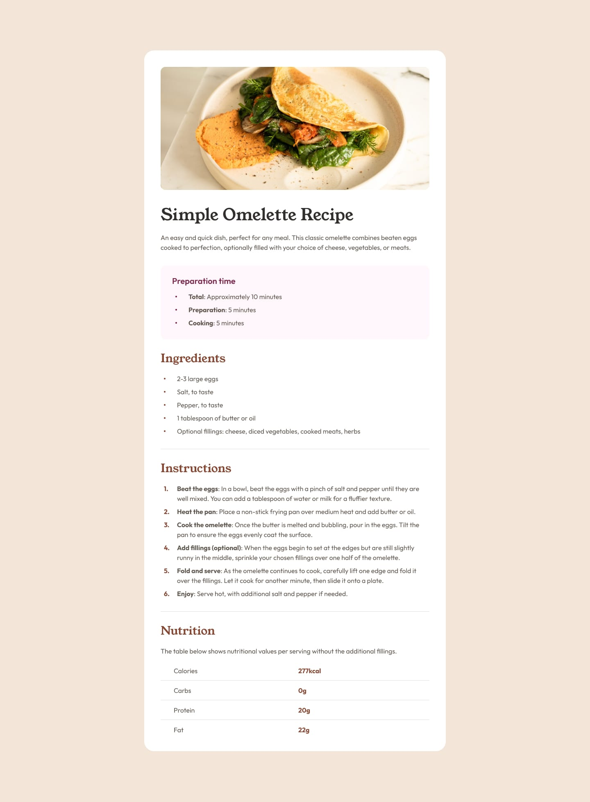

# Una página de receta

Organiza y da estilo a una receta de tortilla siguiendo las referencias. El archivo `index.html` contiene todo el texto que necesitas, en inglés. Tú debes añadir las etiquetas HTML y escribir el CSS dentro de `<style>`.

## Tu tarea

1. Abre `index.html` con Live Server. Si no lo tienes instalado, busca **Live Server**, de Ritwick Dey, en las extensiones de VS Code e instálalo.
2. Organiza la receta con un título principal, una introducción y los apartados de tiempo de preparación, ingredientes, instrucciones e información nutricional.
3. Enlaza la imagen `assets/images/image-omelette.jpeg` con una descripción en el atributo `alt`.
4. Usa una lista desordenada para ingredientes, una ordenada para los pasos y una tabla para los datos nutricionales. Destaca las palabras relevantes con `<strong>`.
5. Elige tus propias clases CSS y escribe las reglas necesarias para reproducir el diseño.
6. Practica el ancho en porcentaje, `max-width` y los tamaños en `rem`. Ajusta los espacios observando las referencias.
7. Reduce el ancho de la ventana y comprueba que se puede leer la receta sin desplazamiento horizontal.

## Diseño esperado

- [Ver diseño para una ventana amplia](design/desktop-design.jpg).
- [Ver diseño para una pantalla pequeña](design/mobile-design.jpg).



El resultado es aproximado. Prioriza la estructura, la legibilidad y los espacios entre bloques.

## Colores de referencia

| Parte | Color |
| --- | --- |
| Fondo de página | `#f3e6d8` |
| Fondo de la receta | `#ffffff` |
| Separadores | `#e4ded8` |
| Texto general | `#5f574e` |
| Título principal | `#302d2c` |
| Títulos de ingredientes, instrucciones y nutrición | `#854632` |
| Título del tiempo de preparación | `#7b284f` |
| Fondo del tiempo de preparación | `#fff5fa` |

## Fuentes incluidas

- **Young Serif:** para el título principal y los títulos de los apartados.
- **Outfit:** para el texto general.

Los archivos están en `assets/fonts`. Sus licencias se conservan en los archivos `OFL.txt` correspondientes. Consulta [la guía de estilo](style-guide.md) para localizar los archivos.

## Cómo incluir las fuentes

Las fuentes ya están descargadas en la carpeta `assets/fonts`. Para utilizarlas, primero debes registrar sus archivos y después aplicarlas a los elementos de la página.

### 1. Registra las fuentes con `@font-face`

Copia estas reglas al principio de la etiqueta `<style>` de `index.html`, antes de tus otras reglas CSS:

```css
@font-face {
  font-family: "Outfit";
  src: url("assets/fonts/outfit/static/Outfit-Regular.ttf");
  font-weight: 400;
}

@font-face {
  font-family: "Outfit";
  src: url("assets/fonts/outfit/static/Outfit-Bold.ttf");
  font-weight: 700;
}

@font-face {
  font-family: "Young Serif";
  src: url("assets/fonts/young-serif/YoungSerif-Regular.ttf");
  font-weight: 400;
}
```

- `@font-face` permite registrar una fuente para usarla en la página.
- `font-family` le da un nombre que utilizarás después en tu CSS.
- `src: url(...)` indica dónde está el archivo. Estas rutas son relativas a `index.html`, porque estamos escribiendo el CSS dentro de su etiqueta `<style>`.
- `font-weight` identifica el grosor del archivo: `400` es normal y `700` es negrita. Los dos archivos de Outfit comparten el mismo nombre de familia.

### 2. Aplica las fuentes con `font-family`

Añade estas propiedades a las reglas de tu página:

```css
body {
  font-family: "Outfit", Arial, sans-serif;
}

h1 {
  font-family: "Young Serif", Georgia, serif;
  font-weight: normal;
}

h2 {
  font-family: "Young Serif", Georgia, serif;
  font-weight: normal;
}
```

El texto de la página hereda Outfit desde `body`. Los títulos utilizan Young Serif porque sus reglas indican otra fuente. Las fuentes que aparecen después de la primera coma son alternativas por si la principal no se puede cargar.

En la referencia, el título del tiempo de preparación utiliza **Outfit en negrita**. Aplica esa excepción con una clase cuyo nombre elijas tú.

Cuando utilices `<strong>` o `font-weight: bold` en un texto con Outfit, el navegador seleccionará el archivo de grosor `700` que has registrado.

### 3. Comprueba el resultado

Guarda `index.html` y ábrelo con Live Server. Los títulos deben tener remates en las letras (Young Serif), mientras que el texto general utiliza Outfit. Si no cambian, revisa las rutas, los nombres de las familias y que los archivos sigan en sus carpetas originales.

## Etiquetas que puedes utilizar

`main`, `section`, `img`, `h1`, `h2`, `p`, `ul`, `ol`, `li`, `strong`, `table`, `tr`, `th` y `td`.

## Ayuda sobre unidades relativas

- Un ancho en `%` depende del ancho del contenedor.
- `max-width` pone un límite al crecimiento de la caja.
- `rem` toma como referencia el tamaño de letra del elemento raíz. Si ese tamaño es de 16 px, `1rem` equivale a 16 px.
- Para que el padding forme parte del ancho declarado, puedes utilizar `box-sizing: border-box`.

## Comprueba tu trabajo

- La jerarquía de títulos y las listas reflejan la estructura de la receta.
- La imagen tiene un texto alternativo y se adapta a su contenedor.
- Los datos nutricionales aparecen en una tabla, con encabezados de fila.
- Las medidas relativas permiten adaptar el contenido al ancho disponible.
- Conservas el texto completo de la receta y utilizas colores hexadecimales.
