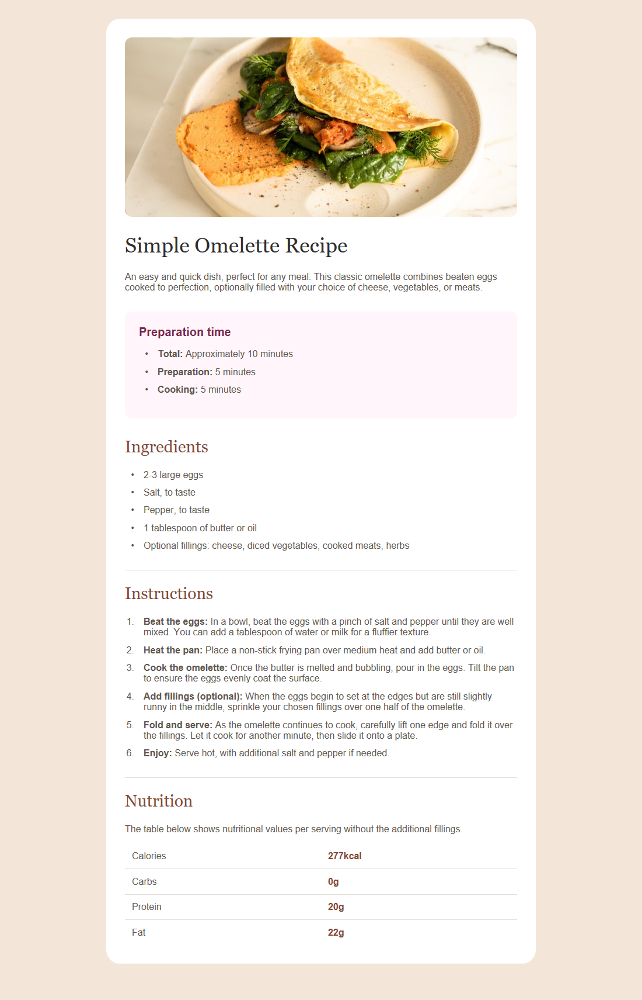

# Una página de receta

Organiza y da estilo a una receta de tortilla siguiendo las referencias. El archivo `index.html` contiene todo el texto que necesitas, en inglés. Tú debes añadir las etiquetas HTML y escribir el CSS en `estilos.css`, que ya está enlazado desde el HTML.

## Tu tarea

1. Abre `index.html` con Live Server. Si no lo tienes instalado, busca **Live Server**, de Ritwick Dey, en las extensiones de VS Code e instálalo.
2. Organiza la receta con un título principal, una introducción y los apartados de tiempo de preparación, ingredientes, instrucciones e información nutricional.
3. Enlaza la imagen `assets/images/image-omelette.jpeg` con una descripción en el atributo `alt`.
4. Usa una lista desordenada para ingredientes, una ordenada para los pasos y una tabla para los datos nutricionales. Utiliza `<b>` para destacar las etiquetas de los tiempos y el inicio de cada paso, sin atribuirles una importancia especial.
5. Elige tus propias clases CSS y escribe las reglas necesarias para reproducir el diseño.
6. Practica el ancho en porcentaje, `max-width` y los tamaños en `rem`. Ajusta los espacios observando las referencias.
7. Reduce el ancho de la ventana y comprueba que se puede leer la receta sin desplazamiento horizontal.

## Diseño esperado

- [Ver diseño para una ventana amplia](disenoEsperado.png).
- [Ver diseño para una pantalla pequeña](disenoEsperado-movil.png).



El resultado es aproximado. Prioriza la estructura, la legibilidad y los espacios entre bloques.

## Colores de referencia

| Parte | Color |
| --- | --- |
| Fondo de página | `#f3e6d8` |
| Fondo de la receta | `#ffffff` |
| Separadores | `#e4ded8` |
| Texto general | `#5f574e` |
| Título principal | `#302d2c` |
| Títulos de ingredientes, instrucciones y nutrición | `#854632` |
| Título del tiempo de preparación | `#7b284f` |
| Fondo del tiempo de preparación | `#fff5fa` |

## Archivo CSS y modelo de caja

El archivo `index.html` ya enlaza la hoja de estilos externa situada en esta misma carpeta:

```html
<link rel="stylesheet" href="estilos.css">
```

Escribe tus reglas en `estilos.css`. Al principio encontrarás esta regla preparada:

```css
* {
  box-sizing: border-box;
}
```

El selector `*` aplica la regla a todos los elementos. Con `border-box`, el ancho declarado incluye el contenido, el padding y el borde. El margen sigue quedando fuera. Esto ayuda a que las cajas con ancho en porcentaje se ajusten a su contenedor.

## Tipos de letra

Utiliza fuentes del sistema:

- **Arial:** para el texto general.
- **Georgia:** para el título principal y los títulos de los apartados.
- El título del tiempo de preparación utiliza **Arial en negrita**.

Puedes aplicar las fuentes así en `estilos.css`:

```css
body {
  font-family: Arial, sans-serif;
}

h1 {
  font-family: Georgia, serif;
  font-weight: normal;
}

h2 {
  font-family: Georgia, serif;
  font-weight: normal;
}
```

El texto hereda Arial desde `body`. Los títulos utilizan Georgia porque sus reglas indican otra fuente. `sans-serif` y `serif` son familias genéricas de reserva: el navegador elegirá una alternativa si la primera fuente no está disponible.

Para el título del tiempo de preparación, aplica Arial y negrita con una clase cuyo nombre elijas tú.

## Etiquetas que puedes utilizar

`main`, `section`, `img`, `h1`, `h2`, `p`, `ul`, `ol`, `li`, `b`, `table`, `tr`, `th` y `td`.

## Ayuda sobre unidades relativas

- Un ancho en `%` depende del ancho del contenedor.
- `max-width` pone un límite al crecimiento de la caja.
- `rem` toma como referencia el tamaño de letra del elemento raíz. Si ese tamaño es de 16 px, `1rem` equivale a 16 px.
- La regla `box-sizing: border-box` ya está preparada para que el padding y el borde formen parte del ancho declarado.

## Comprueba tu trabajo

- La jerarquía de títulos y las listas reflejan la estructura de la receta.
- La imagen tiene un texto alternativo y se adapta a su contenedor.
- Los datos nutricionales aparecen en una tabla, con encabezados de fila.
- Las medidas relativas permiten adaptar el contenido al ancho disponible.
- Conservas el texto completo de la receta y utilizas colores hexadecimales.
